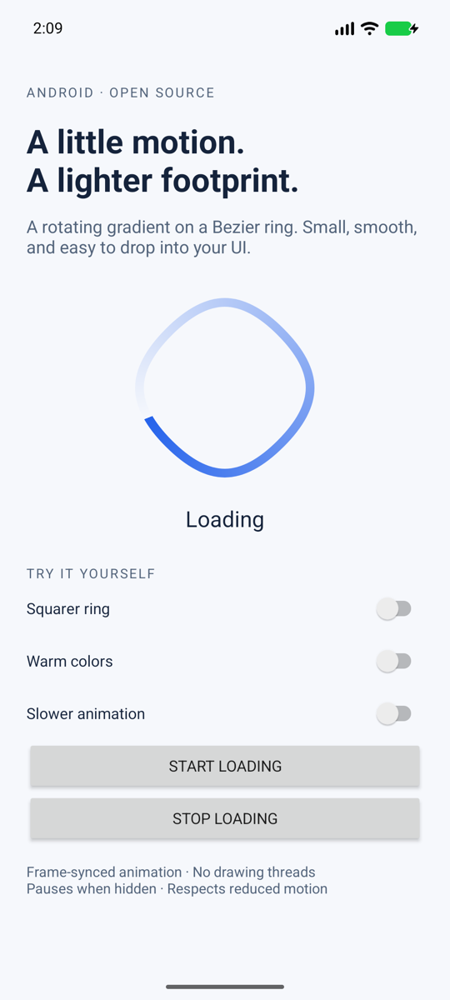

# BesselLoadingView

一个轻量的 Android **Loading 组件**：四段三次贝塞尔曲线构成环形，渐变沿环旋转。使用 Kotlin 自定义 View，支持 XML、Kotlin 和 Compose 的 `AndroidView` 接入。



- 保留贝塞尔环的曲线造型，可调整控制角度、线宽、渐变色和转速。
- `start()` / `stop()` 控制加载；默认自动开始，停止后保留当前画面。
- 隐藏、离开窗口或移除时停止动画，重新显示时按加载状态恢复。
- 遵循系统动画时长设置；系统关闭动画时显示静态环。
- 背景透明，支持 padding、非正方形尺寸、RTL、状态恢复和无障碍加载语义。

## 接入

Android 6.0（API 23）及以上。组件运行时只依赖 Android SDK 和 Kotlin 标准库，不需要 AppCompat、Material 或 Compose。

源码包含两个模块：`besselloadingview` 是组件，`app` 是可直接运行的示例。

在此工程中使用：

```kotlin
dependencies {
    implementation(project(":besselloadingview"))
}
```

也可以构建 AAR，或发布到本机 Maven 仓库供其他工程使用：

```sh
./gradlew :besselloadingview:assembleRelease
./gradlew :besselloadingview:publishReleasePublicationToMavenLocal
```

AAR 位于 `besselloadingview/build/outputs/aar/`。使用本机 Maven 时，在消费工程的仓库配置中加入 `mavenLocal()`，然后添加：

```kotlin
implementation("io.github.stormblue:bessel-loading-view:2.0.0")
```

该坐标用于本地发布；项目尚未发布到 Maven Central。

## 使用

```xml
<com.bluestrom.gao.customview.BesselLoadingView
    xmlns:android="http://schemas.android.com/apk/res/android"
    xmlns:app="http://schemas.android.com/apk/res-auto"
    android:id="@+id/loading"
    android:layout_width="64dp"
    android:layout_height="64dp"
    android:padding="4dp"
    android:contentDescription="正在加载数据"
    app:bessel_autoStart="true"
    app:bessel_strokeWidth="4dp"
    app:bessel_startColor="#002563EB"
    app:bessel_endColor="#FF2563EB"
    app:bessel_duration="1400"
    app:bessel_shapeAngle="9.875864" />
```

```kotlin
val loading = findViewById<BesselLoadingView>(R.id.loading)
loading.start()
loading.stop()

loading.durationMillis = 1000L
loading.strokeWidth = 6f * resources.displayMetrics.density
loading.shapeAngle = 30f
```

所有操作在主线程执行。`start()`、`stop()` 可重复调用，也可在 View 添加到窗口前调用。`stop()` 只冻结动画；需要隐藏组件时设置 `visibility = View.GONE`。View 配置恢复需要稳定的 `android:id`。

### 参数

| XML 属性 | Kotlin 属性 | 默认值 | 说明 |
| --- | --- | --- | --- |
| `bessel_autoStart` | `isLoading`（只读），`start()` / `stop()` | `true` | 初始加载状态；`isLoading` 表示请求加载，隐藏或系统禁用动画时仍可为 true |
| `bessel_strokeWidth` | `strokeWidth` | `4dp` | XML 为 dimension，代码为 px，必须为有限正数；极小尺寸会限制实际线宽 |
| `bessel_startColor` | `startColor` | `#002563EB` | 渐变起色，支持透明度 |
| `bessel_endColor` | `endColor` | `#FF2563EB` | 渐变终色，支持透明度 |
| `bessel_duration` | `durationMillis` | `1400` | 顺时针旋转一周的毫秒数，必须大于 0，受系统动画倍率影响 |
| `bessel_shapeAngle` | `shapeAngle` | `9.875864` | 贝塞尔控制角度，有限值 `0..45` 度；越大越接近方形 |

`wrap_content` 的默认内容尺寸为 `48dp × 48dp`，额外加上 padding。非正方形区域内居中绘制，按短边缩放。

### Compose 中使用

在已有 Compose 工程中使用 `AndroidView`，无需为组件额外加入 Compose 依赖：

```kotlin
AndroidView(
    factory = { context -> BesselLoadingView(context) },
    modifier = Modifier.size(64.dp),
    update = { view ->
        if (isLoading) view.start() else view.stop()
        view.contentDescription = "正在加载数据"
    },
)
```

## 示例与验证

示例展示加载启停、曲线形状、冷暖渐变和慢速动画，并支持深色模式和系统栏 Insets。

工具链：AGP **9.5.1**（内置 Kotlin）、Gradle **9.9.1**、compile/target SDK **37**，Java 字节码目标 **17**。本机验证使用 JDK **25**。Android Studio 打开项目后运行 `app`，或执行：

```sh
./gradlew :app:assembleDebug :app:assembleRelease
./gradlew :app:lintDebug :besselloadingview:lintDebug
./gradlew :besselloadingview:connectedDebugAndroidTest
```

设备测试要求已连接设备或启动 AVD。验证范围及性能观测见 [验证记录](docs/verification.md)。GitHub Actions 在 `main` 的提交和 PR 上执行构建、Lint 和测试 APK 编译。

## 绘制与性能

使用 Android 硬件加速绘制路径；路径与渐变按尺寸或外观变化缓存，稳定动画帧只更新渐变矩阵并绘制一次。组件不创建离屏 Bitmap、Surface、绘制线程或高频 Handler 循环；`ValueAnimator` 与显示帧同步，离开可见窗口后取消。

选择 View 是为了保持这个小组件的依赖和接入成本较低。Compose 也需要完成绘制工作，切换 UI 框架本身不能证明性能会提升。优化遵循 Google 的 [自定义 View 性能建议](https://developer.android.com/develop/ui/views/layout/custom-views/optimizing-view)。工具链版本见 [AGP 发布说明](https://developer.android.com/build/releases/gradle-plugin)。

## License

[Apache License 2.0](LICENSE)
